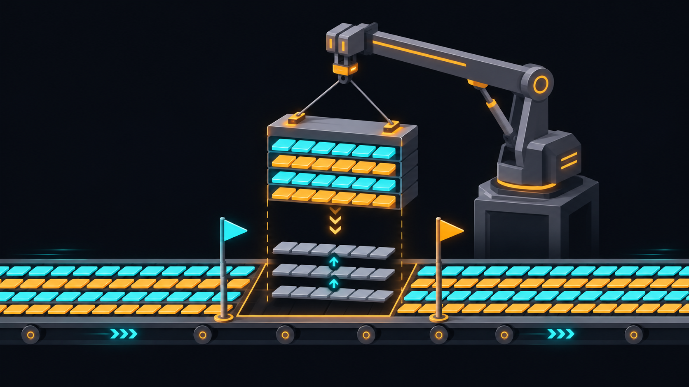
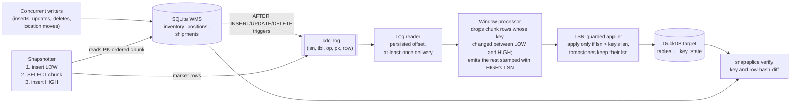

# snapsplice

[](https://github.com/SlateGitOrg/snapsplice/actions/workflows/ci.yml)



snapsplice backfills an analytics store from a live warehouse-management database without a lock and without a maintenance window. It reads the table in primary-key-ordered chunks and splices each chunk into the change log between a low and a high watermark, following the watermark-based chunk algorithm of the DBLog paper (Netflix, 2020). The source is SQLite, the target is DuckDB, and the change log is an offline stand-in for a binlog. A seeded scheduler interleaves concurrent writes, snapshot steps, delivery faults and a snapshotter crash, and the target equals the source at the end of every schedule tested (seeded random schedules, plus an exhaustive enumeration of every interleaving of one chunk with three writes). That is evidence from bounded testing, not a proof. The same seeds are run against two naive backfill strategies, and every key on which they diverge is classified.

All data is synthetic. It comes from a seeded generator in `snapsplice.synth`.

## The problem

A third-party logistics operator replicates its warehouse-management system (inventory positions and shipments) into an analytics store through change-data-capture. Bootstrapping a new table, or re-syncing one after the target was corrupted, needs a full copy while the system keeps taking writes.

A long `SELECT *` either blocks the people picking orders or yields a copy the change stream cannot repair. Rows that changed after the page was read overwrite newer values from the stream. Rows that were deleted after the page was read come back. Teams respond with maintenance windows, or they live with silent drift between the system of record and the warehouse.

## How it works



Each replicated table has `AFTER INSERT`, `UPDATE` and `DELETE` triggers that append to `_cdc_log(lsn, tbl, op, pk_json, row_json)`. A watermark is a row inserted into `_cdc_watermarks`; its trigger writes it into the same log, so a marker has an LSN that orders it against every data change. An update that changes a primary key is logged as a delete plus an insert, which is also how a location move is written.

For one chunk the snapshotter inserts a LOW marker, selects the next `C` rows after the last completed key into memory, and inserts a HIGH marker. The log processor sees the markers in LSN order. Any event for that table between LOW and HIGH removes its key from the chunk buffer, because the log already carries the key's newer state. At HIGH the remaining rows are emitted as snapshot rows stamped with HIGH's LSN. Progress (table, chunk id, last upper key) is written to the target in the same transaction as the chunk, so a restarted snapshotter resumes there.

Correctness rests on two rules:

1. A chunk row is emitted only if no change to its key appears in the log between that chunk's LOW and HIGH watermarks.
2. Every applied event, snapshot rows included, must carry a higher LSN than the key's last applied LSN, tombstones included. A delete leaves a row in `_key_state` with its LSN, so a snapshot row that arrives late cannot bring the key back.

The log reader delivers batches at least once, interleaves tables differently from run to run, and keeps LSN order within a table. Snapshot rows travel on a separate path and can be applied late. The first rule keeps stale rows out of the stream; the second makes duplicates, reordering between the two paths, and re-emitted chunks harmless.

The baselines read the table in PK-ordered pages interleaved with writes, as a long dump without a consistent snapshot does:

* `naive`: tailing starts at the LSN when the dump starts; the dumped rows are applied as plain upserts when the dump completes, without LSN guards.
* `dump-then-tail`: tailing starts at the LSN when the dump ends.

## Quick start

Requires Python 3.11 or newer.

```bash
python -m venv .venv
.venv/bin/pip install -e ".[dev]"

# a seeded source database: 3,000 positions, 1,500 shipments, triggers on
.venv/bin/snapsplice generate --out wms.db

# backfill while 4,000 seeded writes hit the source; faults on (duplicate delivery,
# delayed snapshot rows, a snapshotter crash)
.venv/bin/snapsplice run --source wms.db --target target.duckdb --seed 7

# compare the target with the source by key and row hash (exit code 1 on any difference)
.venv/bin/snapsplice verify --source wms.db --target target.duckdb

# the timeline of one key: log events, chunk membership, the decision for each
.venv/bin/snapsplice trace --table inventory_positions --key SKU-0004,L1 \
    --source wms.db --target target.duckdb

# divergence statistics per strategy over 200 seeded schedules (about six minutes)
.venv/bin/snapsplice bench --seeds 200
```

`run --strategy naive` and `--strategy dump-then-tail` run the baselines on the same kind of schedule. `run` modifies the source file (that is the workload), so generate a fresh one per run.

Scope: snapsplice bootstraps an initially empty target. It does not remove keys that exist in the target but not in the source, so re-syncing a corrupted target means starting from an empty one; `verify` will report such leftover keys as extra.

## Example output

All numbers below come from running the commands above on the seeded data.

`snapsplice bench --seeds 200` runs every strategy on seeds 1 to 200. For one seed the strategies share the synthetic population and the scheduler parameters (operation count and mix, chunk size, fault rates), not the exact write stream: the writer aims part of its writes at the chunk the running strategy is on, so two strategies see different writes for the same seed. Each run is reproducible from its seed. Configuration: tests-size (300 inventory positions, 200 shipments, 400 operations per schedule), chunks of 25 rows.

```
                                     divergence over 200 seeded schedules
┏━━━━━━━━━━━━━━━━┳━━━━━━━━━━━━━━┳━━━━━━━━━━━━━━┳━━━━━━━━━━━━━━┳━━━━━━━━━━━━━┳━━━━━━━━━━━━━━┳━━━━━━━━━┳━━━━━━━┓
┃                ┃ schedules    ┃ schedules    ┃ divergent    ┃             ┃ resurrected  ┃         ┃       ┃
┃ strategy       ┃ run          ┃ diverged     ┃ keys         ┃ stale value ┃ delete       ┃ missing ┃ extra ┃
┡━━━━━━━━━━━━━━━━╇━━━━━━━━━━━━━━╇━━━━━━━━━━━━━━╇━━━━━━━━━━━━━━╇━━━━━━━━━━━━━╇━━━━━━━━━━━━━━╇━━━━━━━━━╇━━━━━━━┩
│ watermark      │ 200          │ 0            │ 0            │ 0           │ 0            │ 0       │ 0     │
│ naive          │ 200          │ 200          │ 3220         │ 2196        │ 1024         │ 0       │ 0     │
│ dump-then-tail │ 200          │ 200          │ 4425         │ 2557        │ 1171         │ 697     │ 0     │
└────────────────┴──────────────┴──────────────┴──────────────┴─────────────┴──────────────┴─────────┴───────┘
```

`naive` loses no rows because its tail starts before the dump does, so every insert is seen. `dump-then-tail` misses inserts into ranges it has already read. Neither baseline produced an `extra_row` (a target key that was never deleted and is not in the source): a primary key only disappears through a logged delete here, so every surplus key is a resurrected delete. The class exists so that `verify` and `bench` name that case if it ever happens.

`snapsplice run --seed 7` on the generated demo database:

```
                                   run: watermark, seed 7
┏━━━━━━━━━━━━━━━━━━━━━━━━━━━━━━━━━━━━━━━━━━━┳━━━━━━━━━━━━━━━━━━━━━━━━━━━━━━━━━━━━━━━━━━━━━━━┓
┃ metric                                    ┃ value                                         ┃
┡━━━━━━━━━━━━━━━━━━━━━━━━━━━━━━━━━━━━━━━━━━━╇━━━━━━━━━━━━━━━━━━━━━━━━━━━━━━━━━━━━━━━━━━━━━━━┩
│ scheduler ticks                           │ 9647                                          │
│ writer operations                         │ delete 579, insert 798, move 118, update 2505 │
│ log events read                           │ 4304                                          │
│ events applied / rejected by LSN guard    │ 4118 / 177                                    │
│ chunks emitted / re-emitted after restart │ 93 / 0                                        │
│ chunk rows dropped in window              │ 460                                           │
│ snapshot rows applied / rejected          │ 4084 / 51                                     │
│   of which rejected by a tombstone        │ 16                                            │
│ duplicate batches delivered               │ 100                                           │
│ delayed snapshot batches                  │ 8                                             │
│ snapshotter crashed after chunk           │ 32                                            │
│ divergent keys vs source                  │ 0                                             │
└───────────────────────────────────────────┴───────────────────────────────────────────────┘
```

`snapsplice trace --table inventory_positions --key SKU-0004,L1` on the same run: the key is updated inside chunk 1's window, so the chunk row is dropped and the log value (226) lands.

```
                                     inventory_positions key SKU-0004,L1
┏━━━━━━┳━━━━━━━━━━━┳━━━━━━━━━━━━━━━━━━━━━━━━━━━━━━━━━━━━━━━━━━━━━━━━━━━┳━━━━━━━━━━━━━━━━━━━━━━━━━━━━━━━━━━━━━┓
┃ lsn  ┃ record    ┃ detail                                            ┃ decision                            ┃
┡━━━━━━╇━━━━━━━━━━━╇━━━━━━━━━━━━━━━━━━━━━━━━━━━━━━━━━━━━━━━━━━━━━━━━━━━╇━━━━━━━━━━━━━━━━━━━━━━━━━━━━━━━━━━━━━┩
│ 13   │ insert    │ qty_on_hand=211 qty_allocated=37                  │ not applied (before backfill start) │
│      │           │ updated_at=2026-03-02T06:00:00                    │                                     │
│ 4517 │ wm_low    │ chunk 1                                           │ window opened                       │
│ 4533 │ update    │ qty_on_hand=226 qty_allocated=36                  │ applied                             │
│      │           │ updated_at=2026-03-02T06:00:33  (inside window of │                                     │
│      │           │ chunk 1)                                          │                                     │
│ 4550 │ chunk_row │ chunk 1: low=4517 high=4550 conflict_lsn=4533     │ dropped_in_window                   │
└──────┴───────────┴───────────────────────────────────────────────────┴─────────────────────────────────────┘
```

## Design decisions

* **Markers go through the log, not around it.** LOW and HIGH are rows in a source table whose trigger copies them into `_cdc_log`. The window is then defined by LSN order on the one stream the applier already trusts, so no clock or lock is needed to say what "between" means. The cost is that the source needs a small writable table; a read-only replica could not host the markers.
* **Drop on conflict instead of reconciling.** A chunk row whose key changed in the window is discarded rather than compared with the log value. That is conservative (a key changed before the SELECT is dropped too) but always safe, because the log carries the key's state. The cost is that heavily written keys may be dropped from several chunk attempts; 460 of about 4,600 chunk rows were dropped in the demo run.
* **One guard for everything.** Log events and snapshot rows both pass the same rule: apply only if the LSN is greater than the key's stored LSN, and keep tombstones. This replaces ordering guarantees between the log path and the snapshot path, so delayed snapshot application, duplicate redelivery and a re-run chunk need no special cases. The cost is a `_key_state` row for every key ever touched, deleted keys included.
* **One chunk in flight, in-memory window state.** The snapshotter waits for HIGH to be seen in the log before it starts the next chunk, so at most one window is open and a crash loses only that window. A restarted snapshotter matches markers by watermark id and ignores those of the dead attempt. The cost is latency: chunks are not pipelined.
* **Progress and chunk commit together.** The chunk rows, their key state and the progress row are written in one DuckDB transaction. A delayed or repeated chunk can therefore make a restart redo work, never skip it; progress is append-only and only the furthest row counts.
* **DuckDB writes are delete-then-insert.** `INSERT OR REPLACE` costs a fixed amount per statement in DuckDB, several times that of a delete followed by a bulk insert in one transaction. Batches are applied that way, which is what keeps 600 schedules in the bench to a few minutes.

## Testing

```bash
.venv/bin/python -m pytest -q
```

The suite runs offline and takes about 75 seconds. It contains:

* hand-built fixtures for each rule: an update between the watermarks (dropped, and `trace` shows `dropped_in_window`), a delete after SELECT, a delete after HIGH with a delayed snapshot apply, and inserts into completed, current and future ranges;
* trigger tests: every operation is logged with a strictly increasing LSN, and replaying the whole log into an empty target reproduces the source;
* an exhaustive check of one chunk: every merge of the three snapshot steps, three writer operations and a log drain (140 orders), for three write scenarios (update/delete/re-insert of one key, insert ahead of the chunk, a location move), each under plain delivery, delayed snapshot application and duplicate delivery of every batch; all end equal to the source;
* a crash-recovery fixture: a chunk is emitted but still held, so no progress is saved; the snapshotter is killed, restarts from the older progress, redoes the chunk, and the old batch lands after the redo, with a delete in between;
* 25 seeded schedules: the watermark strategy ends with zero divergent keys in every one, both baselines diverge, their class counts sum to their divergent-key totals, and the schedules reach both the tombstone rejection and the later-update rejection of snapshot rows;
* duplicate delivery of every batch, a snapshotter killed after chunk k (k from the seed, at each of four points in the chunk cycle), chunk sizes 1, 7, 50 and larger than the table, and location moves keeping per-SKU quantity totals;
* `verify` on a deliberately tampered target reporting exactly one missing, one extra and one changed key.

## Project layout

```
src/snapsplice/
  schema.py        table specs, source DDL and triggers, target DDL
  synth.py         seeded population and configurations (tests, demo)
  source.py        SQLite access: log reads, chunk selects, watermark inserts
  workload.py      the concurrent writer, with writes aimed at the chunk in flight
  pipeline.py      log reader, at-least-once delivery, persisted offset
  snapshotter.py   watermark chunk state machine and window processing
  strategies.py    watermark, naive and dump-then-tail behind one interface
  applier.py       LSN-guarded and plain appliers
  target.py        DuckDB target, bookkeeping tables, trace recording
  sim.py           deterministic scheduler and fault injection
  verify.py        key and row-hash comparison, divergence classes
  bench.py         divergence statistics over many schedules
  trace.py         per-key timeline
  cli.py           generate, run, verify, bench, trace
tests/             fixtures, schedules, pipeline, workload and CLI tests
```

## License

MIT
